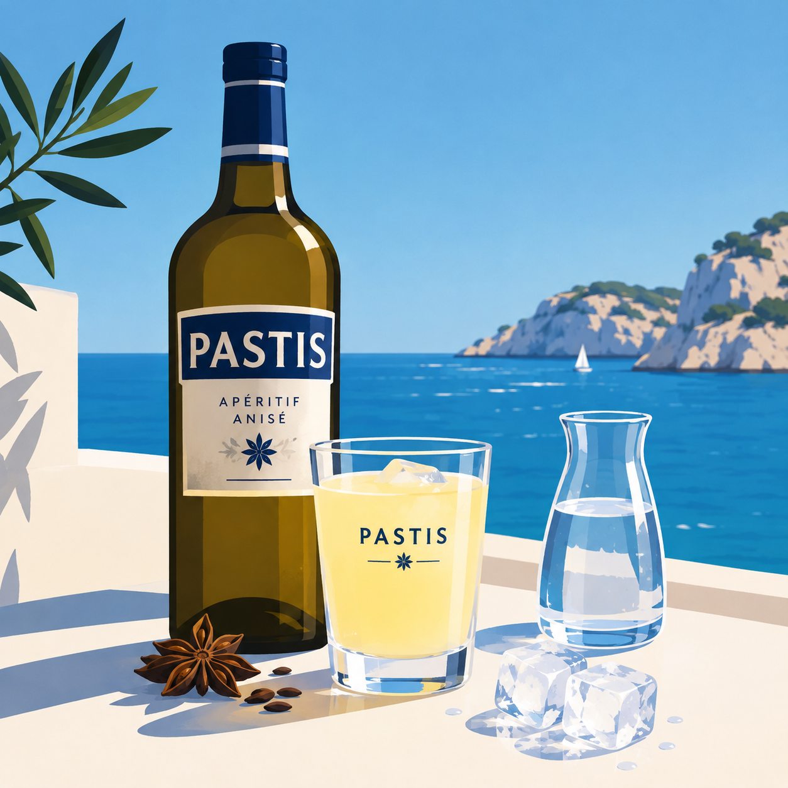

# Le pastis

*Bienvenue, vous voilà face à une présentation en MarkDown d’une boisson anisée provençale.*  

*Lisez avec modération*

## Sommaire

- [Qu’est-ce que le pastis ?](#quest-ce-que-le-pastis-)
- [Pourquoi l’appelle-t-on « le pastaga » ?](#pourquoi-lappelle-t-on--pastaga--)
- [Comment le boire et l’apprécier ?](#comment-le-boire-et-la-pprecier-)
- [Les meilleurs combo !](#les-meilleurs-combo-)
- [Les risques liés à l’alcool](#les-risques-lies-a-l-alcool)
- [Le pastis et la Provence](#le-pastis-et-la-provence)
- [Idées reçues](#idees-recues)
- [! TECHNIQUE SECRETE!](#technique-secrète)
- [Sources](#sources)


## Qu’est-ce que le pastis ?

Le pastis est une boisson alcoolisée anisée, traditionnellement associée au sud de la France et à la Provence, et biensur à MARSEILLE.   
Son nom vient du provençal *pastís*, qui signifie « mélange ». Il est généralement élaboré à partir d’alcool, d’anis et d’autres plantes ou épices, dont les recettes varient selon les marques.

Lorsqu’on ajoute de l’eau au pastis, il devient trouble et prend une teinte laiteuse. Ce phénomène est appelé « effet louche » : certains composants aromatiques de l’anis, peu solubles dans l’eau, se dispersent en fines gouttelettes.

## Pourquoi l’appelle-t-on « pastaga » ?

**« Pastaga »** est un surnom familier et affectueux du pastis, surtout employé dans le langage populaire des sudistes. Il donne un ton décontracté à la conversation: on peut, par exemple, dire « prendre un pastaga » pour parler d’un verre de pastis. -> Que c'est beau!

Le mot évoque souvent l’image conviviale de l’apéritif provençal, le cliché des mots Marseillais, mais **il s’agit d’un surnom**, **pas d’une catégorie particulière de pastis.**


## Comment le boire et l’apprécier ?

### La recette du petit pastis

**Ingrédients :**
- 1 dose de pastis
- 5 à 7 doses d’eau fraîche, à ajuster selon les goûts
- Quelques glaçons, si tu aimes ton apéritif bien frais
- Un verre et un peu de patience : le pastis n’est pas un sprint

**Préparation :**
1. Verse le pastis dans le verre.
2. Ajoute l’eau fraîche doucement. Le mélange devient trouble : c’est l’effet louche, pas le verre qui a perdu ses lunettes.
3. Ajoute les glaçons si tu le souhaites. L’ordre classique, c’est d’abord l’eau, puis les glaçons.
4. Goûte et ajuste la quantité d’eau jusqu’à trouver ton équilibre : plus d’eau pour une saveur plus douce, moins pour un goût plus marqué.
5. Prends le temps de le savourer — et accompagne-le, si ça te dit, de quelques olives ou de dés de fromage.

Il n’y a pas de dosage magique: chacun prépare son verre à son goût. En revanche, le pastis contient de l’alcool. À consommer avec modération, et pas de conduite après avoir bu. Pour en savoir plus, consulte la partie [Les dangers de l’alcool](#les-dangers-de-lalcool).


## Les meilleurs combo !

Pour changer un peu, voici **quelques mélanges** à essayer :

- **Pastis et sirop d’orgeat** : une touche douce et parfumée, souvent appelée *Mauresque*.
- **Pastis et sirop de menthe** : un mélange frais, parfois appelé *Perroquet*.
- **Pastis et sirop de grenadine** : une note fruitée et sucrée, connue sous le nom de *Tomate*.

Les noms et les proportions peuvent varier selon les endroits et les habitudes. Mieux vaut commencer avec une petite quantité de sirop, goûter, puis ajuster. Ces boissons contiennent de l’alcool: à savourer avec modération, et sans conduire après en avoir bu.
D'ailleurs, voici les dangers de l'alcool:


Voici une version prête à coller dans ton `README.md`, avec un ton léger. Pour le classement, je te propose une méthode de dégustation plutôt qu’un podium présenté comme une vérité absolue : les goûts, eux, n’ont pas encore élu de maire.

## Les risques liés à l’alcool

Le pastis a beau avoir l’accent du soleil, il contient de l’alcool — et l’alcool ~~c'est cool~~ comporte des risques pour la santé. Plus on en consomme, plus ces risques augmentent. Le verre convivial peut donc vite devenir le verre de trop : le soleil provençal n’est pas un bouclier anti-alcool.

Pour limiter les risques, les repères français recommandent de ne pas dépasser **2 verres standards par jour**, **10 par semaine**, et de prévoir des jours sans alcool. Ce sont des repères de réduction des risques, pas une garantie d’absence de danger.

**Zéro alcool** notamment avant de conduire, pendant la grossesse, ou avec certains médicaments. Si tu as bu, laisse le volant à quelqu’un qui n’a pas trinqué — ou prends un autre moyen de rentrer. Pour plus d’informations, consulte [Santé publique France](https://www.santepubliquefrance.fr/alcool/comment-reduire-les-risques-de-la-consommation-dalcool).

## Le pastis et la Provence

Le pastis est fortement associé à la Provence et, en particulier, à l’imaginaire marseillais : une terrasse, des amis, le chant des cigales… et quelqu’un qui affirme très sérieusement que *son* dosage est le seul valable.

Mais la Provence ne se résume pas à un verre anisé. Le pastis fait partie d’une culture de l’apéritif et d’un art de prendre son temps. On le retrouve souvent dans les souvenirs de vacances, les parties de pétanque et les longues discussions où personne ne sait vraiment qui a gagné.

Bref, le pastis évoque la Provence ; il ne remplace ni la visite de la région, ni une bonne bouteille d’eau.


## Idées reçues

- **« Il faut forcément être en Provence pour boire du pastis. »**  
  Non : une terrasse en Provence aide pour l’ambiance, mais n’est pas nécessaire à la préparation.

- **« Plus il y a de glaçons, meilleur est le verre. »**  
  Pas forcément. L’essentiel est de le préparer selon ses goûts et de ne pas laisser les glaçons prendre toute la place.

- **« Il existe une seule bonne proportion d’eau. »**  
  Chacun préfère son mélange. Le meilleur dosage est celui qui te plaît — pas celui défendu le plus fort par le voisin.

- **« Un verre de pastis, c’est juste de l’anis et de l’eau. »**  
  Le pastis est une boisson alcoolisée anisée, et les recettes peuvent aussi comporter d’autres plantes et épices.

- **« Le café après l’apéritif fait disparaître l’alcool. »**  
  Non : le café ne rend pas apte à conduire. Si tu as bu, ne prends pas le volant.  
    

  
# Technique secrète
```markdown
## Technique secrète : le pastis inversé

La méthode classique ? Le pastis d’abord, l’eau ensuite.  
La méthode du professeur Maiolo de l’apéro ? On inverse l’ordre !
**MAIS ATTENTION: **
Technique réservée aux initiés, aux soldats, aux courageux... Une fois réalisée, cette technique se retourne contre son utilisateur, soyez prudent(e) et bien entouré(e).  

**La recette :**
1. Versez de l’eau fraîche dans un verre (pas + que la moitié).
2. Ajoutez TRES délicatement une dose de pastis en le laissant couler sur les parroies.
3. Constatez que **l'eau et le pastis ne se sont pas mélangés !**.
4. Vous avez maintenant un Pastis Inversé.
4. C'est le grand moment... CUL SEC !
5. Aprécier cette sensation unique, et ne parlez de cette technique à personne.

À déguster avec modération : pour les risques et les précautions, direction la section [Les risques liés à l’alcool](#les-risques-lies-a-lalcool).
```

La section santé reprend les repères de réduction des risques indiqués par Santé publique France ; tu peux garder ce lien dans la partie **Sources** du README.

## Sources

- [Règlement (UE) 2019/787 — EUR-Lex](https://eur-lex.europa.eu/eli/reg/2019/787/oj?locale=fr) — définition réglementaire du pastis et des boissons spiritueuses anisées.
- [Comment réduire les risques de la consommation d’alcool — Santé publique France](https://www.santepubliquefrance.fr/alcool/comment-reduire-les-risques-de-la-consommation-dalcool) — risques liés à l’alcool et repères de consommation à moindre risque.
- [Les anisés et l’absinthe — Fédération Française des Spiritueux](https://www.spiritueux.fr/spiritueux/les-anises-et-labsinthes/) — informations sur les boissons anisées, leur élaboration et le pastis.
- [Everything You Need to Know About Pastis — Taste France Magazine](https://www.tastefrance.com/magazine/french-pantry/everything-you-need-know-about-pastis) — aperçu de l’histoire, des usages et de la place du pastis dans la culture française.
